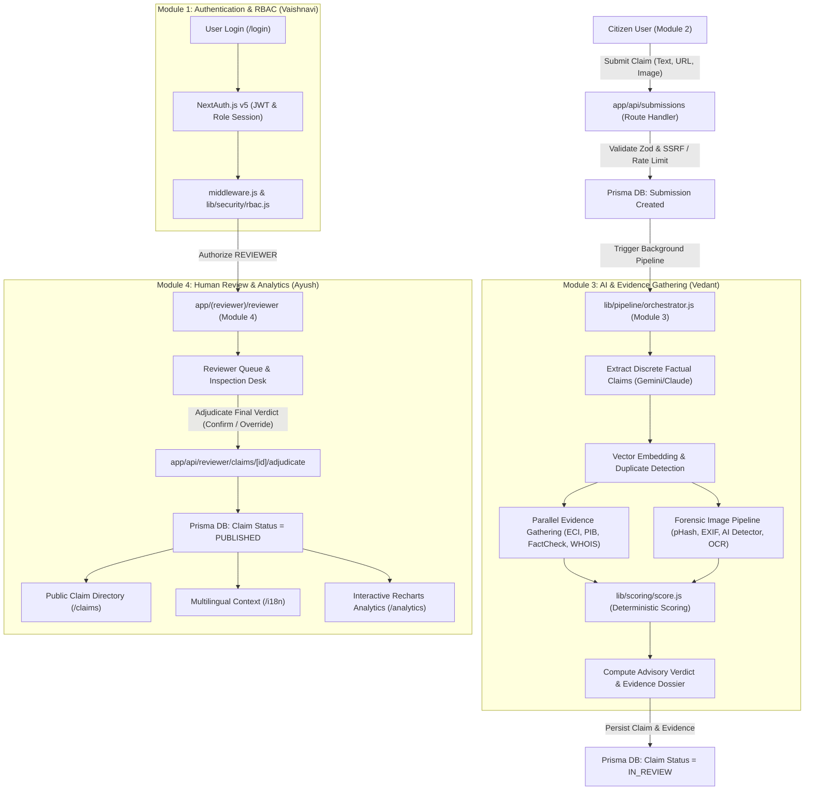

# SatyaVote AI: Comprehensive Project Architecture, Syllabus Mapping & Viva Guide

**Project Title:** SatyaVote AI — AI-Assisted Election Information Verification Platform  
**Target Courses:** 
- **INT252:** Web App Development with React.js
- **INT257:** Modern Web Application Development with Next.js  
**Technology Stack:** JavaScript (ES6+), React 19, Next.js 16 (App Router), Tailwind CSS, NextAuth.js v5, Prisma ORM, PostgreSQL (Supabase)

---

## 1. Executive Summary & Problem Statement

In democratic elections, viral misinformation—such as manipulated voter turnout photos, fabricated polling booth hours, and false voting rules—spreads faster than official fact-checkers can respond. 

**SatyaVote AI** addresses this crisis through a structured, transparent **Human-in-the-Loop (HITL)** architecture:
1. **Citizen Ingestion:** Citizens submit text claims, social media URLs, or image screenshots.
2. **AI-Assisted Evidence Gathering:** The platform queries authoritative election databases (ECI statutory rules, PIB Fact Check Unit, Google Fact Check Tools) and conducts image forensics (perceptual hashing, EXIF metadata, OCR).
3. **Conservative Deterministic Scoring:** A mathematical scoring engine evaluates independent source diversity, stance, and image veracity, outputting an advisory verdict (`SUPPORTED`, `CONTRADICTED`, `MISLEADING`, `UNVERIFIED`).
4. **Mandatory Human Review:** Accredited election reviewers inspect the gathered evidence dossier, verify or amend the verdict, and certify the final verdict before publication.
5. **Public Transparency & Analytics:** Verified debunks are published to an immutable public claim repository with multilingual support (English, Hindi, Punjabi) and live analytics dashboards.

---

## 2. Project Team & Module Distribution

The project is divided into four distinct, self-contained functional modules, assigned to individual team members:

| Module | Module Name | Main Responsibilities | Frontend Files | Backend / Lib Files | Team Member |
|---|---|---|---|---|---|
| **Module 1** | **Authentication & RBAC** | User login, session management, Role-Based Access Control (`SUBMITTER`, `REVIEWER`, `ADMIN`), route protection middleware, admin user & source management, security audit logging. | `app/(auth)/login/page.jsx`<br>`app/unauthorized/page.jsx`<br>`app/(admin)/admin/page.jsx` | `auth.config.js`<br>`auth.js`<br>`middleware.js`<br>`lib/security/rbac.js`<br>`app/api/auth/[...nextauth]/route.js`<br>`app/api/admin/**/route.js` | **Vaishnavi** |
| **Module 2** | **Claim Submission & Ingestion** | Multimodal intake (plain text, news URLs with automated scraping, image attachments), SSRF security filtering, IP rate limiting, input validation, live pipeline polling. | `app/(public)/submit/page.jsx`<br>`app/(public)/result/[id]/page.jsx`<br>`app/(public)/result/[id]/loading.jsx` | `lib/security/ssrf.js`<br>`lib/security/rate-limit.js`<br>`lib/integrations/scrape.js`<br>`lib/ai/schemas.js`<br>`app/api/submissions/route.js`<br>`app/api/submissions/[id]/route.js` | **Sushmita** |
| **Module 3** | **AI Verification & Evidence Gathering** | LLM claim extraction & decomposition, multi-source evidence retrieval (ECI, PIB, FactCheck, WHOIS), image forensics (Perceptual Hash, EXIF, AI detection), conservative mathematical verdict scoring, background pipeline orchestration. | Shared pipeline triggers in submission result | `lib/pipeline/orchestrator.js`<br>`lib/ai/provider.js`<br>`lib/ai/prompts/*.js`<br>`lib/claims/matching.js`<br>`lib/scoring/score.js`<br>`lib/integrations/*.js`<br>`app/api/pipeline/run/route.js` | **Vedant** |
| **Module 4** | **Human Review & Public Reporting** | Reviewer triage queue, side-by-side evidence inspection desk, human verdict adjudication, public certified claims search library, i18n multilingual localization context, Recharts analytics dashboards. | `app/(reviewer)/reviewer/page.jsx`<br>`app/(reviewer)/reviewer/claim/[id]/page.jsx`<br>`app/(public)/claims/page.jsx`<br>`app/(public)/claims/[id]/page.jsx`<br>`app/(public)/analytics/page.jsx`<br>`components/navbar.jsx`<br>`components/analytics/*.jsx` | `lib/reviewer/schemas.js`<br>`lib/reviewer/service.js`<br>`lib/analytics/stats.js`<br>`lib/i18n/context.jsx`<br>`lib/i18n/translations.js`<br>`app/api/reviewer/**/route.js`<br>`app/api/claims/route.js`<br>`app/api/analytics/route.js` | **Ayush** |

---

## 3. End-to-End Application Workflow



---

## 4. Module-Wise Detailed Code Explanations & Viva Preparation

---

### MODULE 1: Authentication & Role-Based Access Control (RBAC)
**Responsible Team Member:** **Vaishnavi**  
**Core Syllabi Mappings:**
- **INT257 Unit V:** Authentication and Authorization in Next.js (NextAuth.js, Credentials Provider, JWT session management).
- **INT257 Unit IV:** Next.js Route Handlers and Edge Middleware (`NextResponse.redirect`, request interception).
- **INT252 Unit IV & V:** React Controlled Components, State Management with `useState`, error handling.

---

#### Code Block 1.1: NextAuth Configuration with Role Claims (`auth.config.js` & `auth.js`)
```javascript
// auth.config.js
import Credentials from "next-auth/providers/credentials";
import bcrypt from "bcryptjs";
import prisma from "@/lib/db/prisma";

export const authConfig = {
  pages: {
    signIn: "/login",
    error: "/login",
  },
  callbacks: {
    async jwt({ token, user }) {
      if (user) {
        token.id = user.id;
        token.role = user.role;
      }
      return token;
    },
    async session({ session, token }) {
      if (token && session.user) {
        session.user.id = token.id;
        session.user.role = token.role;
      }
      return session;
    },
  },
  providers: [
    Credentials({
      async authorize(credentials) {
        if (!credentials?.email || !credentials?.password) return null;
        const user = await prisma.user.findUnique({
          where: { email: credentials.email.toLowerCase() },
        });
        if (!user || !user.passwordHash) return null;
        const isValid = await bcrypt.compare(credentials.password, user.passwordHash);
        if (!isValid) return null;
        return { id: user.id, name: user.name, email: user.email, role: user.role };
      },
    }),
  ],
};
```
* **Purpose:** Provides a secure, stateless authentication mechanism using email/password credentials, validating against hashed passwords stored in Supabase PostgreSQL and appending the user's role to the encrypted JWT token.
* **Step-by-Step Execution:**
  1. The user submits email and password from the login form.
  2. NextAuth invokes the `authorize()` callback, querying Prisma for the corresponding user.
  3. `bcrypt.compare()` verifies the plaintext password against the stored bcrypt hash.
  4. On successful match, user properties (including `role: 'SUBMITTER' | 'REVIEWER' | 'ADMIN'`) are returned.
  5. The `jwt` callback attaches the `role` onto the JSON Web Token.
  6. The `session` callback transfers `token.role` to `session.user.role`, making it accessible to client components via `useSession()` and server components via `auth()`.
* **Syllabus Concept:** **INT257 Unit V — NextAuth.js & JWT Session Management**.
* **Why Needed:** Traditional sessions require a database lookup on every single request. JWT tokens allow stateless, cryptographically signed authorization checks that scale effortlessly without database bottlenecks.
* **Viva Questions & Answers:**
  * **Q1:** *Why do we attach the user role in both the `jwt` and `session` callbacks?*  
    **A:** In NextAuth with JWT strategy, the `jwt` callback is executed whenever a JSON Web Token is created or updated. The `session` callback is executed whenever a session is checked on the client or server. To make custom properties like `role` accessible in `session.user`, they must first be persisted into the token and then mapped into the session.
  * **Q2:** *Why is `bcrypt.compare` necessary instead of simple string comparison `password === user.passwordHash`?*  
    **A:** Passwords must never be stored in plaintext. `bcrypt` uses salted, slow cryptographic one-way hashing. `bcrypt.compare` safely hashes the provided input with the salt extracted from the hash and compares them in constant time to prevent timing attacks.

---

#### Code Block 1.2: Centralized Route Protection Middleware (`middleware.js`)
```javascript
// middleware.js
import { NextResponse } from "next/server";
import { auth } from "@/auth";

export default auth((req) => {
  const { nextUrl } = req;
  const isLoggedIn = !!req.auth;
  const userRole = req.auth?.user?.role;
  const pathname = nextUrl.pathname;

  // Protect Admin Portal
  if (pathname.startsWith("/admin")) {
    if (!isLoggedIn) return NextResponse.redirect(new URL("/login", nextUrl));
    if (userRole !== "ADMIN") return NextResponse.redirect(new URL("/unauthorized", nextUrl));
  }

  // Protect Reviewer Workdesk
  if (pathname.startsWith("/reviewer")) {
    if (!isLoggedIn) return NextResponse.redirect(new URL("/login", nextUrl));
    if (userRole !== "REVIEWER" && userRole !== "ADMIN") {
      return NextResponse.redirect(new URL("/unauthorized", nextUrl));
    }
  }

  return NextResponse.next();
});

export const config = {
  matcher: ["/admin/:path*", "/reviewer/:path*", "/api/admin/:path*", "/api/reviewer/:path*"],
};
```
* **Purpose:** Intercepts incoming HTTP requests at the edge before route handlers or React server components execute, enforcing role restrictions.
* **Step-by-Step Execution:**
  1. The Next.js routing engine matches the requested URL path against `config.matcher`.
  2. The wrapped `auth` function inspects the encrypted session cookie on the request headers.
  3. If an unauthenticated user attempts to access `/reviewer` or `/admin`, they are redirected to `/login`.
  4. If a authenticated user with role `SUBMITTER` attempts to access `/admin`, they are redirected to `/unauthorized`.
  5. Authorized requests pass through via `NextResponse.next()`.
* **Syllabus Concept:** **INT257 Unit IV & V — Edge Middleware & Route Protection**.
* **Why Needed:** Without middleware, unauthorized users could trigger server component rendering and data fetching before a client-side redirect could occur, risking data leakage.
* **Viva Questions & Answers:**
  * **Q1:** *Where does Next.js middleware execute?*  
    **A:** Next.js middleware executes on the server runtime (or Edge runtime) before the request reaches the page renderer or route handler.
  * **Q2:** *What is the purpose of the `config.matcher` property?*  
    **A:** `matcher` optimizes application performance by filtering which routes trigger the middleware, preventing unnecessary middleware execution on static assets, images, and public pages.

---

### MODULE 2: Claim Submission & Ingestion Pipeline
**Responsible Team Member:** **Sushmita**  
**Core Syllabi Mappings:**
- **INT252 Unit V:** Forms, Controlled Inputs, Form Submission Lifecycle (`e.preventDefault()`, loading state).
- **INT252 Unit IV:** React Hooks (`useState`, `useEffect`, `useRouter`).
- **INT257 Unit I & IV:** Route Handlers (`app/api/submissions/route.js`), Request Parsing, Zod Schema Validation.
- **INT257 Unit III:** Dynamic Routing (`/result/[id]`), `React.use()` for promise unwrapping.

---

#### Code Block 2.1: Controlled Multimodal Submission Form (`app/(public)/submit/page.jsx`)
```jsx
// app/(public)/submit/page.jsx (Excerpt)
"use client";

import { useState } from "react";
import { useRouter } from "next/navigation";

export default function SubmitClaimPage() {
  const router = useRouter();
  const [submissionType, setSubmissionType] = useState("TEXT");
  const [text, setText] = useState("");
  const [url, setUrl] = useState("");
  const [loading, setLoading] = useState(false);
  const [error, setError] = useState(null);

  async function handleSubmit(e) {
    e.preventDefault();
    setLoading(true);
    setError(null);

    try {
      const payload = {
        type: submissionType,
        text: submissionType === "TEXT" ? text : undefined,
        url: submissionType === "URL" ? url : undefined,
      };

      const res = await fetch("/api/submissions", {
        method: "POST",
        headers: { "Content-Type": "application/json" },
        body: JSON.stringify(payload),
      });

      const data = await res.json();
      if (!res.ok) throw new Error(data.error || "Submission failed");

      // Redirect to dynamic result tracking page
      router.push(`/result/${data.submissionId}`);
    } catch (err) {
      setError(err.message);
    } finally {
      setLoading(false);
    }
  }

  return (
    <form onSubmit={handleSubmit} className="space-y-4">
      {/* Radio tabs for switching TEXT vs URL */}
      <div className="flex gap-4">
        <button type="button" onClick={() => setSubmissionType("TEXT")}
          className={submissionType === "TEXT" ? "btn-active" : "btn-idle"}>
          Text Claim
        </button>
        <button type="button" onClick={() => setSubmissionType("URL")}
          className={submissionType === "URL" ? "btn-active" : "btn-idle"}>
          Article / Post URL
        </button>
      </div>

      {submissionType === "TEXT" ? (
        <textarea
          value={text}
          onChange={(e) => setText(e.target.value)}
          placeholder="Paste election-related rumor or message here..."
          required
          className="w-full p-3 rounded-lg bg-slate-900 border"
        />
      ) : (
        <input
          type="url"
          value={url}
          onChange={(e) => setUrl(e.target.value)}
          placeholder="https://example.com/news-post"
          required
          className="w-full p-3 rounded-lg bg-slate-900 border"
        />
      )}

      {error && <p className="text-rose-400 text-sm">{error}</p>}

      <button type="submit" disabled={loading} className="btn-primary">
        {loading ? "Submitting for Verification..." : "Verify Information"}
      </button>
    </form>
  );
}
```
* **Purpose:** Implements a reactive, controlled form interface in React allowing citizens to toggle between text and URL inputs, manages local component state, prevents native browser reload, and posts the payload to the backend route handler.
* **Step-by-Step Execution:**
  1. The user selects whether they are submitting raw text or a news URL; `submissionType` state toggles conditionally rendered input elements.
  2. Input values are bound to React state (`text` or `url`) via `onChange` events (Controlled Component pattern).
  3. On clicking Submit, `handleSubmit` calls `e.preventDefault()` to stop the default browser GET reload.
  4. `fetch()` dispatches a JSON `POST` request to `/api/submissions`.
  5. Upon receiving HTTP 201 with `data.submissionId`, `router.push()` navigates to the dynamic result tracker `/result/[id]`.
* **Syllabus Concept:** **INT252 Unit V — Controlled Components & Form Validation; INT257 Unit III — Client-side Navigation with `useRouter`**.
* **Why Needed:** Controlled inputs keep form data in React state, providing instant validation, disable state on buttons during pending requests, and smooth client-side page transitions without page flashes.
* **Viva Questions & Answers:**
  * **Q1:** *What is the difference between a controlled and uncontrolled component in React?*  
    **A:** In an uncontrolled component, form data is handled by the DOM itself (accessed via `useRef`). In a controlled component, form input state is managed directly within React state via `value` and `onChange`, making React the single source of truth.
  * **Q2:** *Why must `"use client"` be specified at the top of this file?*  
    **A:** Next.js 16 App Router components default to Server Components. Hooks such as `useState`, `useEffect`, and event listeners like `onSubmit` or `onClick` require client-side browser APIs and React interactivity, which necessitate the `"use client"` boundary.

---

#### Code Block 2.2: Rate Limiting & SSRF Protected Submission Route Handler (`app/api/submissions/route.js`)
```javascript
// app/api/submissions/route.js (Excerpt)
import { NextResponse } from "next/server";
import prisma from "@/lib/db/prisma";
import { checkRateLimit } from "@/lib/security/rate-limit";
import { validateExternalUrl } from "@/lib/security/ssrf";
import { scrapeArticleText } from "@/lib/integrations/scrape";
import { z } from "zod";

const submissionSchema = z.object({
  type: z.enum(["TEXT", "URL", "IMAGE"]),
  text: z.string().min(10).max(5000).optional(),
  url: z.string().url().optional(),
});

export async function POST(req) {
  // 1. IP Rate Limiting
  const clientIp = req.headers.get("x-forwarded-for")?.split(",")[0] || "127.0.0.1";
  const rateLimit = checkRateLimit(clientIp, { maxRequests: 10, windowMs: 60000 });
  if (!rateLimit.allowed) {
    return NextResponse.json({ error: "Rate limit exceeded. Try again in 1 minute." }, { status: 429 });
  }

  // 2. Body Validation
  const body = await req.json();
  const parsed = submissionSchema.safeParse(body);
  if (!parsed.success) {
    return NextResponse.json({ error: "Invalid submission data", issues: parsed.error.issues }, { status: 400 });
  }

  let rawText = parsed.data.text || "";

  // 3. SSRF-Safe Web Scraping for URLs
  if (parsed.data.type === "URL" && parsed.data.url) {
    const isUrlSafe = await validateExternalUrl(parsed.data.url);
    if (!isUrlSafe) {
      return NextResponse.json({ error: "Access to private or restricted network URLs is forbidden." }, { status: 400 });
    }
    const scraped = await scrapeArticleText(parsed.data.url);
    rawText = scraped.title ? `${scraped.title}\n\n${scraped.body}` : scraped.body;
  }

  // 4. Persistence in Database
  const submission = await prisma.submission.create({
    data: {
      type: parsed.data.type,
      rawText,
      sourceUrl: parsed.data.url,
      status: "RECEIVED",
    },
  });

  return NextResponse.json({ submissionId: submission.id, status: "RECEIVED" }, { status: 201 });
}
```
* **Purpose:** Handles POST requests for new submissions on the server, enforcing IP rate limiting, Zod schema validation, SSRF network protection against private IPs (`127.0.0.1`, `10.0.0.0/8`, `192.168.0.0/16`), and parsing articles with Cheerio.
* **Syllabus Concept:** **INT257 Unit IV — Route Handlers, Zod Validation, HTTP Status Codes**.
* **Why Needed:** Server-Side Request Forgery (SSRF) is a critical vulnerability where an attacker passes `http://169.254.169.254` or internal microservices to scrape cloud metadata. The SSRF guard resolves DNS records and drops loopback/private IPv4 ranges before making requests.
* **Viva Questions & Answers:**
  * **Q1:** *How does Next.js handle API endpoints in the App Router compared to the Pages Router?*  
    **A:** In the Pages Router, API routes used default exported handler functions `handler(req, res)` inside `pages/api/`. In the App Router, Route Handlers reside in `app/api/**/route.js` and use named export functions matching HTTP verbs (`GET`, `POST`, `PATCH`, `DELETE`), returning `NextResponse` objects.
  * **Q2:** *Why use `safeParse()` instead of `parse()` with Zod?*  
    **A:** `parse()` throws an exception on validation failure, requiring a `try/catch` block. `safeParse()` returns a discriminated union object `{ success: true, data }` or `{ success: false, error }`, resulting in cleaner, more predictable control flow.

---

### MODULE 3: AI Verification & Evidence Gathering
**Responsible Team Member:** **Vedant**  
**Core Syllabi Mappings:**
- **INT257 Unit IV:** Asynchronous Pipeline Orchestration, Vector Search, External API Integration.
- **INT252 Unit I:** ES6+ Promises, `Promise.allSettled`, Array transformations (`map`, `filter`, `reduce`).
- **INT257 Unit VI:** Prisma Complex Queries, Transactions, Mathematical Scoring Logic.

---

#### Code Block 3.1: Parallel Multi-Source Evidence Gathering (`lib/pipeline/orchestrator.js`)
```javascript
// lib/pipeline/orchestrator.js (Excerpt)
import { searchOfficialEciGuidelines } from "@/lib/integrations/eci";
import { searchPibFactChecks } from "@/lib/integrations/pib";
import { queryGoogleFactCheck } from "@/lib/integrations/factcheck";
import { analyzeImageForensics } from "@/lib/integrations/image";

export async function gatherEvidenceForClaim(claimText, imageUrl = null) {
  // Execute all independent evidence retrieval jobs in parallel
  const evidenceTasks = [
    searchOfficialEciGuidelines(claimText),
    searchPibFactChecks(claimText),
    queryGoogleFactCheck(claimText),
  ];

  if (imageUrl) {
    evidenceTasks.push(analyzeImageForensics(imageUrl));
  }

  const results = await Promise.allSettled(evidenceTasks);

  // Extract successful evidence items without failing the entire pipeline if one API fails
  const allEvidence = [];
  for (const outcome of results) {
    if (outcome.status === "fulfilled" && Array.isArray(outcome.value)) {
      allEvidence.push(...outcome.value);
    }
  }

  return allEvidence;
}
```
* **Purpose:** Queries multiple independent authoritative sources (ECI statutory database, PIB Fact Check Unit, Google Fact Check API, and image forensics) simultaneously using `Promise.allSettled` to maximize pipeline throughput and fault tolerance.
* **Step-by-Step Execution:**
  1. An array of asynchronous promise tasks is assembled for the extracted claim text.
  2. `Promise.allSettled()` fires all external network requests concurrently.
  3. If one external service encounters a network timeout or rate limit, `Promise.allSettled` marks it `rejected` without throwing an error that aborts the other running tasks.
  4. The fulfilled items are accumulated into a consolidated evidence array.
* **Syllabus Concept:** **INT252 Unit I — Advanced JavaScript Promises (`Promise.allSettled`), Asynchronous Programming**.
* **Why Needed:** Sequential `await` calls would sum network latencies (3s + 2s + 2s = 7s). Parallel execution reduces total response latency to the maximum of the individual calls (~3s total) and guarantees system resilience.
* **Viva Questions & Answers:**
  * **Q1:** *Why is `Promise.allSettled` used here instead of `Promise.all`?*  
    **A:** `Promise.all` fails fast—if any single promise rejects, the entire operation immediately rejects, discarding all other gathered evidence. In an election verification system, if the PIB API is temporarily down, we still want to collect and evaluate ECI and fact-check evidence. `Promise.allSettled` waits for every promise to resolve or reject and returns individual status outcomes.
  * **Q2:** *What is the difference between an event loop microtask and macrotask in Node.js?*  
    **A:** Promise callbacks (`.then()`, `await` continuations) are scheduled on the microtask queue, which executes immediately after the current operation and before the macrotask queue (such as `setTimeout`, `setInterval`, or I/O events) is serviced.

---

#### Code Block 3.2: Domain Deduplication & Conservative Verdict Scoring (`lib/scoring/score.js`)
```javascript
// lib/scoring/score.js (Excerpt)
export function computeClaimScore(evidences, imageAnalysis = null) {
  if (!evidences || evidences.length === 0) {
    return { verdict: "UNVERIFIED", confidence: 0.1, reasoning: "No corroborating or refuting evidence found in authorized databases." };
  }

  // 1. Group evidence by unique publisher domain to eliminate duplicate citation inflation
  const domainMap = new Map();
  for (const ev of evidences) {
    const domain = ev.sourceDomain || "unknown";
    if (!domainMap.has(domain)) {
      domainMap.set(domain, []);
    }
    domainMap.get(domain).push(ev);
  }

  let supportWeight = 0;
  let contradictWeight = 0;
  const usedEvidenceIds = [];

  for (const [domain, items] of domainMap.entries()) {
    // Pick highest credible item per independent domain
    const topItem = items.reduce((best, curr) => (curr.credibilityScore > best.credibilityScore ? curr : best), items[0]);
    usedEvidenceIds.push(topItem.id);

    if (topItem.stance === "SUPPORTS") {
      supportWeight += topItem.credibilityScore;
    } else if (topItem.stance === "CONTRADICTS") {
      contradictWeight += topItem.credibilityScore;
    }
  }

  // 2. Conservative handling of conflicting evidence
  if (supportWeight > 0.8 && contradictWeight > 0.8) {
    return {
      verdict: "UNVERIFIED",
      confidence: 0.45,
      reasoning: "Conflicting evidence detected between credible sources. Human adjudication is strictly required.",
      usedEvidenceIds,
    };
  }

  // 3. Stance evaluation
  if (contradictWeight >= 1.5 && contradictWeight > supportWeight * 2) {
    return { verdict: "CONTRADICTED", confidence: Math.min(0.98, contradictWeight / 2), usedEvidenceIds };
  }

  if (supportWeight >= 1.5 && supportWeight > contradictWeight * 2) {
    return { verdict: "SUPPORTED", confidence: Math.min(0.98, supportWeight / 2), usedEvidenceIds };
  }

  return { verdict: "UNVERIFIED", confidence: 0.35, reasoning: "Available evidence does not meet certainty threshold.", usedEvidenceIds };
}
```
* **Purpose:** Implements conservative, audit-compliant deterministic mathematical scoring. It groups evidence by independent domain (preventing 5 articles from the same newspaper from counting 5 times) and flags conflicting evidence as `UNVERIFIED` rather than fabricating certainty.
* **Syllabus Concept:** **INT252 Unit I — JavaScript `Map`, `reduce()`, and Algorithmic Logic**.
* **Why Needed:** LLMs often hallucinate certainty when presented with contradictory inputs. A deterministic scoring engine ensures that election verdicts follow transparent, verifiable mathematical criteria.
* **Viva Questions & Answers:**
  * **Q1:** *Why is domain deduplication critical in election fact-checking?*  
    **A:** If a single partisan blog publishes five identical articles repeating an unverified rumor, counting raw database records would inflate the credibility score 5x. Grouping by unique domain ensures that only genuine, independent sources count toward consensus.
  * **Q2:** *Why does conflicting evidence yield `UNVERIFIED` instead of `MISLEADING`?*  
    **A:** In election matters, when two reputable official bodies or news sources contradict each other, AI must not arbitrate the truth on its own. Marking it `UNVERIFIED` safeguards democracy by forcing human election officers to review the source documents.

---

### MODULE 4: Human Review & Public Reporting
**Responsible Team Member:** **Ayush**  
**Core Syllabi Mappings:**
- **INT252 Unit IV:** React Context API (`useContext`, `createContext`) for multilingual UI switching.
- **INT252 Unit VI:** Data Visualization using Recharts (`BarChart`, `PieChart`, `ResponsiveContainer`).
- **INT257 Unit I & II:** Server Components for dynamic list querying, Client Components for interactive filters.
- **INT257 Unit III:** Dynamic Routes (`/claims/[id]`), Static Generation & Server-Side Rendering.

---

#### Code Block 4.1: Multilingual Localization Context (`lib/i18n/context.jsx`)
```jsx
// lib/i18n/context.jsx
"use client";

import { createContext, useContext, useState, useEffect } from "react";
import { translations } from "./translations";

const LanguageContext = createContext(null);

export function LanguageProvider({ children }) {
  const [language, setLanguage] = useState("en");

  // Persist language preference in browser localStorage
  useEffect(() => {
    const saved = localStorage.getItem("satyavote_lang");
    if (saved && (saved === "en" || saved === "hi" || saved === "pa")) {
      setLanguage(saved);
    }
  }, []);

  function changeLanguage(newLang) {
    setLanguage(newLang);
    localStorage.setItem("satyavote_lang", newLang);
  }

  const t = translations[language] || translations.en;

  return (
    <LanguageContext.Provider value={{ language, setLanguage: changeLanguage, t }}>
      {children}
    </LanguageContext.Provider>
  );
}

export function useTranslation() {
  const ctx = useContext(LanguageContext);
  if (!ctx) throw new Error("useTranslation must be used within LanguageProvider");
  return ctx;
}
```
* **Purpose:** Provides app-wide multilingual localization (English, Hindi, Punjabi) across all components without prop drilling, persisting user preference in `localStorage`.
* **Step-by-Step Execution:**
  1. `createContext` initializes the shared context container.
  2. `LanguageProvider` wraps the application root in `app/layout.jsx`.
  3. `useEffect` checks for previously stored language preferences in `localStorage` on component mount.
  4. The custom hook `useTranslation()` allows any child component to extract the current translation dictionary `t` and the `setLanguage` updater function.
* **Syllabus Concept:** **INT252 Unit IV — React Context API (`createContext`, `useContext`), `useEffect` Hook**.
* **Why Needed:** In a diverse democracy like India, election misinformation must be refuted in the elector's regional language. Context API avoids threading language props through dozens of nested UI components.
* **Viva Questions & Answers:**
  * **Q1:** *What problem does the React Context API solve?*  
    **A:** It solves "prop drilling"—the tedious and error-prone practice of passing data through multiple intermediate components that do not need the data themselves just to deliver it to a deeply nested child.
  * **Q2:** *Why must `localStorage.getItem` be placed inside `useEffect` rather than at the top level of the component?*  
    **A:** In Next.js, components are initially pre-rendered on the server where the browser `window` and `localStorage` objects do not exist. Accessing `localStorage` outside of `useEffect` causes a server-side runtime crash (`ReferenceError: localStorage is not defined`). `useEffect` runs strictly on the client after hydration.

---

#### Code Block 4.2: Certified Claims Directory with Server-Side Filtering (`app/(public)/claims/page.jsx`)
```jsx
// app/(public)/claims/page.jsx (Excerpt)
import prisma from "@/lib/db/prisma";
import Link from "next/link";

export const dynamic = "force-dynamic";

export default async function ClaimsDirectoryPage({ searchParams }) {
  const params = await searchParams;
  const search = params?.q || "";
  const verdictFilter = params?.verdict || "";

  // Query certified claims directly from database on the server
  const claims = await prisma.claim.findMany({
    where: {
      status: "PUBLISHED",
      ...(verdictFilter ? { finalVerdict: verdictFilter } : {}),
      ...(search ? { text: { contains: search, mode: "insensitive" } } : {}),
    },
    orderBy: { publishedAt: "desc" },
    include: {
      evidence: { select: { id: true, sourceName: true, kind: true } },
    },
  });

  return (
    <div className="max-w-6xl mx-auto p-6 space-y-6">
      <h1 className="text-3xl font-bold">Certified Election Claims Repository</h1>
      
      {/* List of Claims */}
      <div className="grid gap-4">
        {claims.map((claim) => (
          <div key={claim.id} className="p-5 rounded-xl bg-slate-900 border border-slate-800">
            <div className="flex justify-between items-start">
              <span className={`px-2.5 py-1 rounded text-xs font-bold ${
                claim.finalVerdict === "CONTRADICTED" ? "bg-rose-500/10 text-rose-400" :
                claim.finalVerdict === "SUPPORTED" ? "bg-emerald-500/10 text-emerald-400" :
                "bg-amber-500/10 text-amber-400"
              }`}>
                {claim.finalVerdict}
              </span>
              <span className="text-xs text-slate-500">Repeated {claim.repeatCount} times</span>
            </div>
            <p className="mt-2 text-slate-200 font-medium">{claim.text}</p>
            <p className="mt-1 text-xs text-slate-400">{claim.finalNote}</p>
            <Link href={`/claims/${claim.id}`} className="mt-3 inline-block text-xs text-blue-400 hover:underline">
              View Evidence Dossier &rarr;
            </Link>
          </div>
        ))}
      </div>
    </div>
  );
}
```
* **Purpose:** Implements a Next.js Server Component that fetches published election claims directly from Supabase via Prisma without client-side waterfalls, zero JavaScript bundle overhead for data fetching, and native search param filtering.
* **Syllabus Concept:** **INT257 Unit II — React Server Components (RSC); INT257 Unit III — Search Params in Server Components**.
* **Why Needed:** Server Components execute solely on the server. They have direct access to database credentials, ship 0KB of extra JavaScript to the client browser, and deliver instant SEO-indexed HTML to citizens.
* **Viva Questions & Answers:**
  * **Q1:** *How does data fetching in Next.js App Router Server Components differ from React's classic `useEffect` + `fetch` approach?*  
    **A:** In classic React, the server sends an empty HTML shell, the browser downloads JavaScript, mounts the component, and only then fires a `fetch` request in `useEffect`, causing a visible loading spinner and layout shift. In Next.js Server Components, `await prisma.claim.findMany()` runs directly on the server before HTML is sent, rendering the complete page immediately with zero client fetch overhead.
  * **Q2:** *Why must `searchParams` be awaited in Next.js 16?*  
    **A:** In Next.js 15 and 16, route `params` and `searchParams` are asynchronous promises to support streaming rendering and partial prerendering (PPR). They must be awaited (`const params = await searchParams;`) before properties are read.

---

#### Code Block 4.3: Interactive Analytics with Recharts (`components/analytics/verdict-chart.jsx`)
```jsx
// components/analytics/verdict-chart.jsx
"use client";

import { ResponsiveContainer, PieChart, Pie, Cell, Tooltip, Legend } from "recharts";

const COLORS = {
  SUPPORTED: "#10b981",    // Emerald
  CONTRADICTED: "#f43f5e", // Rose
  MISLEADING: "#f59e0b",   // Amber
  UNVERIFIED: "#64748b",   // Slate
};

export default function VerdictDistributionChart({ data }) {
  if (!data || data.length === 0) {
    return <p className="text-slate-500 text-sm">No verification data available.</p>;
  }

  return (
    <div className="h-64 w-full">
      <ResponsiveContainer width="100%" height="100%">
        <PieChart>
          <Pie
            data={data}
            cx="50%"
            cy="50%"
            innerRadius={60}
            outerRadius={85}
            paddingAngle={4}
            dataKey="count"
            nameKey="verdict"
          >
            {data.map((entry) => (
              <Cell key={entry.verdict} fill={COLORS[entry.verdict] || "#94a3b8"} />
            ))}
          </Pie>
          <Tooltip
            contentStyle={{ backgroundColor: "#0f172a", borderColor: "#334155", borderRadius: "8px" }}
            itemStyle={{ color: "#f8fafc", fontSize: "12px" }}
          />
          <Legend wrapperStyle={{ fontSize: "12px", paddingTop: "8px" }} />
        </PieChart>
      </ResponsiveContainer>
    </div>
  );
}
```
* **Purpose:** Renders an interactive donut chart showing the breakdown of verified claims (`CONTRADICTED`, `SUPPORTED`, `MISLEADING`, `UNVERIFIED`) using the Recharts data visualization library.
* **Syllabus Concept:** **INT252 Unit VI — Data Visualization & React Ecosystem Integration**.
* **Why Needed:** Tabular statistics are difficult for election observers and journalists to digest quickly. Donut charts provide instant visual clarity regarding the proportion of debunked claims versus verified facts.
* **Viva Questions & Answers:**
  * **Q1:** *What role does `<ResponsiveContainer>` play in Recharts?*  
    **A:** `<ResponsiveContainer>` is a wrapper component that monitors the dimensions of its parent DOM container and automatically scales the SVG chart width and height responsively across mobile, tablet, and desktop screens.
  * **Q2:** *Why must Recharts components reside in a `"use client"` component?*  
    **A:** Recharts relies on client-side SVG rendering, browser DOM measurements (`getBoundingClientRect`), and interactive mouse hover/touch events for tooltips, which cannot execute on the server.

---

## 5. Comprehensive Syllabus Concept Cross-Reference Table

| Course & Unit | Syllabus Topic | Where Implemented in SatyaVote AI | Team Member |
|---|---|---|---|
| **INT252 Unit I** | ES6+ Promises, `Promise.allSettled`, Array methods (`map`, `filter`, `reduce`) | `lib/pipeline/orchestrator.js`, `lib/scoring/score.js` | Vedant |
| **INT252 Unit II** | JSX Expressions, Conditional Rendering, Lists & Keys | `app/page.jsx`, `app/(public)/claims/page.jsx` | Ayush |
| **INT252 Unit III** | Functional Components & Props Passing | `components/navbar.jsx`, `components/analytics/*.jsx` | Ayush |
| **INT252 Unit IV** | React Hooks (`useState`, `useEffect`, `useContext`) | `app/(public)/submit/page.jsx`, `lib/i18n/context.jsx` | Sushmita / Ayush |
| **INT252 Unit V** | Forms, Controlled Components, Validation Lifecycle | `app/(public)/submit/page.jsx`, `app/(auth)/login/page.jsx` | Sushmita / Vaishnavi |
| **INT252 Unit VI** | Data Visualization with Recharts | `components/analytics/verdict-chart.jsx`, `topic-chart.jsx` | Ayush |
| **INT257 Unit I** | Next.js App Router Architecture (`layout.jsx`, `error.jsx`, `not-found.jsx`) | `app/layout.jsx`, `app/error.jsx`, `app/not-found.jsx` | Team Root |
| **INT257 Unit II** | Server Components vs Client Components | `app/(public)/claims/page.jsx` vs `app/(public)/submit/page.jsx` | Ayush / Sushmita |
| **INT257 Unit III** | Dynamic Routes (`[id]`), `React.use()` unwrapping | `app/(public)/result/[id]/page.jsx`, `app/(reviewer)/reviewer/claim/[id]/page.jsx` | Sushmita / Ayush |
| **INT257 Unit IV** | Next.js Route Handlers (`GET`, `POST`, `PATCH`), Zod, SSRF | `app/api/submissions/route.js`, `app/api/reviewer/**` | Sushmita / Ayush |
| **INT257 Unit V** | NextAuth.js v5, Role-Based Access Control, Edge Middleware | `auth.config.js`, `middleware.js`, `lib/security/rbac.js` | Vaishnavi |
| **INT257 Unit VI** | Prisma ORM, PostgreSQL on Supabase, DB Seeding, Vercel Config | `prisma/schema.prisma`, `lib/db/prisma.js`, `prisma/seed.js` | Team Root |

---

## 6. JavaScript Conversion & Academic Design Decisions

1. **Why Pure JavaScript?**  
   The university syllabi for INT252 and INT257 focus on the fundamentals of Modern JavaScript (ES6+), React 19 functional components, hooks, and Next.js 16 core architecture. Converting from TypeScript to JavaScript eliminates complex generic types, `.d.ts` boilerplate, and compilation layers that obscure core syllabus concepts during evaluation and viva examination.
2. **Path Aliasing in JavaScript:**  
   Path aliases (`@/*`) are configured via `jsconfig.json`, allowing clean imports like `import prisma from "@/lib/db/prisma";` without fragile relative paths (`../../`).
3. **Database Layer:**  
   The platform operates on **PostgreSQL hosted on Supabase**, queried through **Prisma ORM**. It features 9 relational models (`User`, `Submission`, `Claim`, `Evidence`, `ImageAnalysis`, `PipelineRun`, `ReviewAction`, `SourceProfile`, `AuditLog`) with full referential integrity and database indexing on foreign keys.

---

## 7. Viva Rapid-Fire Q&A Cheat Sheet

* **Q: What is the single biggest advantage of Next.js 16 over plain React?**  
  **A:** Plain React is a client-side library requiring an external build system and client-side rendering (CSR), causing poor initial load time and weak SEO. Next.js is a full-stack framework offering hybrid Server Components, automatic code splitting, server-side data fetching, edge middleware, and built-in API route handlers.
* **Q: How does SatyaVote AI ensure that AI does not issue misleading election verdicts?**  
  **A:** By enforcing a strict **Human-in-the-Loop** model. The AI and mathematical scoring engine only provide an initial confidence and advisory verdict. Certified claims cannot be published until an authenticated election official (`REVIEWER` role) examines the evidence dossier and signs off on the adjudication.
* **Q: How do you prevent SQL Injection in this project?**  
  **A:** All database operations are handled through Prisma ORM, which automatically parameterizes all SQL queries under the hood, completely neutralizing SQL injection vulnerabilities.
* **Q: How does the app handle Cross-Site Scripting (XSS)?**  
  **A:** React automatically escapes all strings rendered inside JSX expressions (`{claim.text}`) before inserting them into the DOM, preventing arbitrary script injection.
* **Q: What happens if a user submits a claim in Hindi or Punjabi?**  
  **A:** The ingestion pipeline detects the language code (`hi` or `pa`). The claim text is translated to English for vector similarity matching and statutory ECI guideline retrieval, while the original regional text is preserved in `claim.originalText` and displayed to citizens in their native script.
